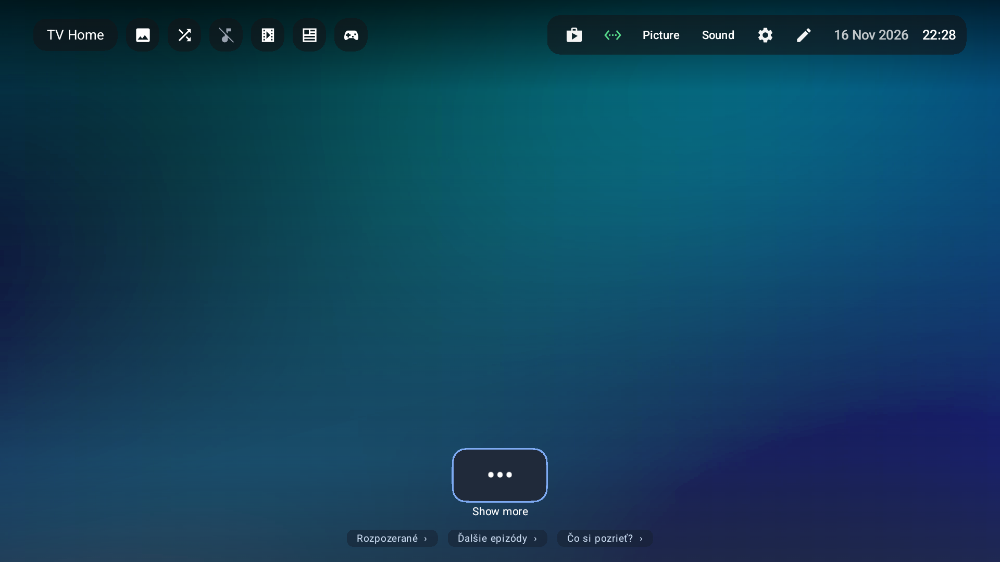
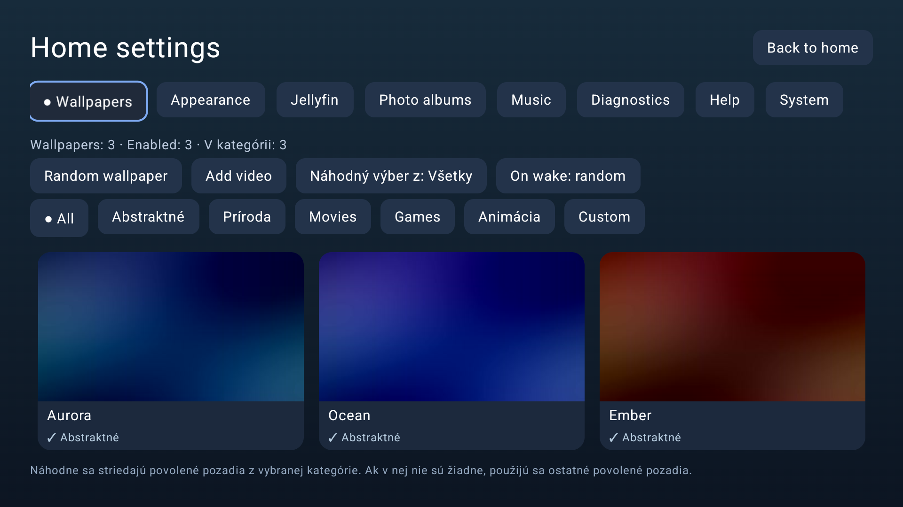
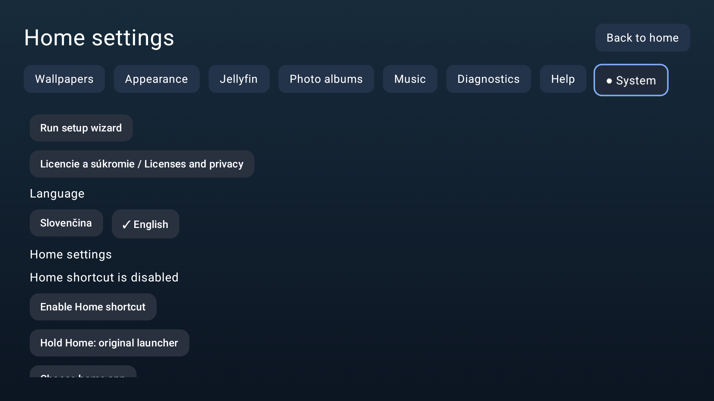
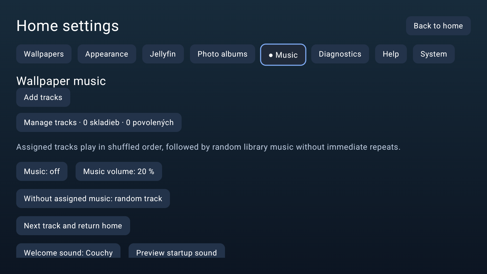
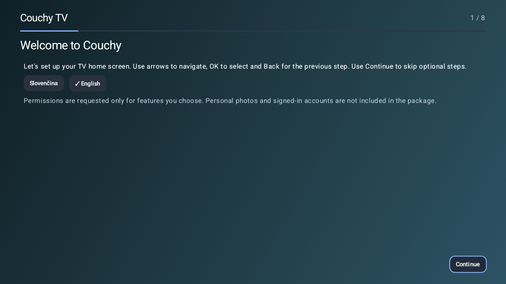
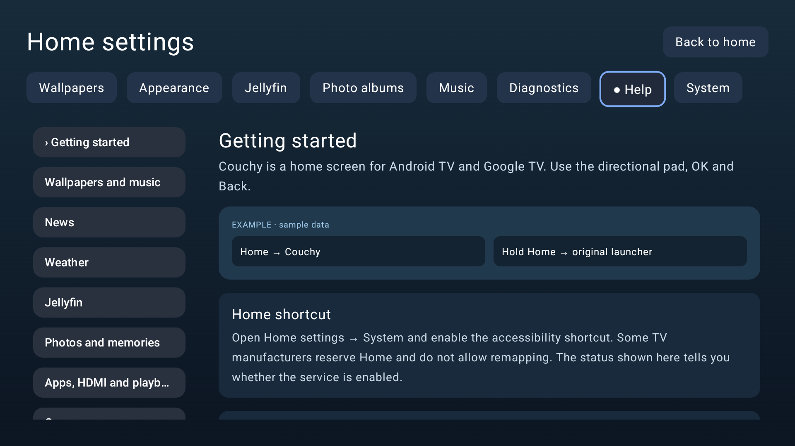
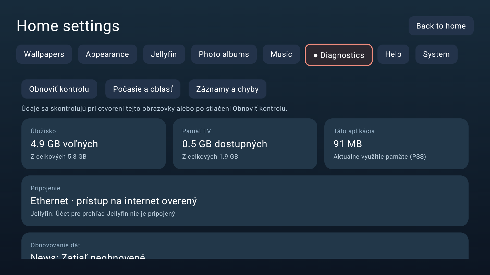

# Couchy TV Open

A remote-first home screen for Android TV and Google TV: animated backgrounds, your apps and media, small everyday widgets, and two local minigames.

This independently maintained edition builds on [Couchy Launcher](https://github.com/conreo/couchy-launcher). It ships **three original 4K abstract video loops**, procedural sound effects, and no personal photos, commercial soundtrack packs or publisher feed presets.



[Download](https://github.com/surzo18/couchy-tv-open/releases/latest) · [User guide](docs/USER-GUIDE.md) · [Feature reference](docs/FEATURES.md) · [Build and tests](docs/TESTING.md) · [Licenses](LICENSING.md)

## What you can do

| Area | Features |
|---|---|
| Home | Reorder favorites, open installed apps and available HDMI inputs, return to the previous app, use an uncluttered idle view. |
| Wallpapers | Import video, edit names and categories, shuffle eligible backgrounds or keep the last one on wake, match accent colors. |
| Music | Import your audio, edit metadata, assign shuffled tracks to backgrounds, fade track edges, control compatible external players. |
| Jellyfin | Quick Connect, reconnect in the UI, continue watching, next episodes, random picks and favorites, season/episode navigation. Playback opens the Jellyfin TV client. |
| News | Add your own HTTPS RSS/Atom feeds; source colors, filtering, summaries, pictures when provided and a shuffled ticker. No feeds enabled initially. |
| Weather | Choose a city, see daily and hourly conditions, switch units or hide the widget. Open-Meteo service conditions apply. |
| New series | TVmaze season premieres around today, descriptions, available ratings and external trailer search. US-oriented seven-day schedule; **not a comprehensive cinema catalog**. |
| Memories | Import photos/video, organize albums, edit captions, select screensaver albums and enable occasional memory cards. No personal albums included. |
| Games | Road crossing and side-view scooter games with local progress, unlocks, challenges, increasing difficulty and original synthesized sound effects. |
| Setup and help | Eight-step onboarding, Slovak/basic English, topic-based help, settings, bounded diagnostics and offline license notices. |

## Gallery

These are actual emulator captures of this public edition, using only its original demo media. There are no personal account credentials or downloaded movie/anime artworks in the gallery. Some screens retain Slovak text: English support is currently partial.

| Wallpaper library | System settings |
|---|---|
|  |  |

| Music settings | First-run setup |
|---|---|
|  |  |

| Help | Diagnostics |
|---|---|
|  |  |

See [the gallery and screenshot provenance](docs/GALLERY.md) for more backgrounds and game views.

## Requirements and compatibility

| Requirement | Details |
|---|---|
| OS | Android TV / Google TV **Android 10+ (API 29)** with Leanback support. Not an APK for other TV operating systems. |
| Input | Remote with directional pad, OK and Back. |
| Display | Layout smoke-tested at 720p, 1080p, UHD and a compact/high-density setting. Overscan and manufacturer layouts may vary. |
| Storage | Reserve about **250 MB** for the app, updates and initial data; this is a planning allowance, not a measured installation minimum. Imported media needs extra space. |
| Live video | A decoder supporting the selected file's codec, resolution and bitrate. Included loops are 3840×2160 H.264 at 24 fps. Use a static background if playback is not smooth. |
| RAM/CPU | No reliable cross-device minimum has been established. Emulator results are not a performance guarantee for a TV. |
| Network | Optional for local games/media; required for configured news, forecasts, TVmaze and reachable Jellyfin servers. |

HDMI names and input switching, Home remapping, picture/sound shortcuts and external playback controls depend on the TV and other apps. A streaming box may not expose the television's HDMI ports. **Keep the original system launcher enabled.**

The UI supports Slovak and basic English; some game text and dynamic messages remain Slovak. Service content is not automatically translated. Weather has an integrated provider, not a general provider plug-in editor. There is no remote administration website.

## Install

1. Download the signed APK and checksums from [Releases](https://github.com/surzo18/couchy-tv-open/releases). See [release verification](RELEASE.md).
2. Sideload through your preferred installer, or run `adb -s YOUR_DEVICE install -r Couchy-TV-Open-1.0.0.apk`. Use an explicit device identifier.
3. Open **Couchy TV Open** and finish the wizard. Optional steps can be skipped. Choose a city and your own feeds/media only if wanted.
4. Enable the optional Home accessibility service or select the default Home app where the TV supports it. Notification access is optional for external-player controls.

Package ID: `io.github.surzo18.couchytv`. This public edition has its own app identity and does not migrate accounts or personal libraries from other builds. Settings survive updates with the same signing key; uninstalling/clearing data removes them.

## Build

```sh
git clone https://github.com/surzo18/couchy-tv-open.git
cd couchy-tv-open/android
# JDK 17+, Android SDK platform 34 and build tools 34.0.0
bash gradlew :app:assembleDebug :app:testDebugUnitTest :app:lintDebug
```

On Windows use `gradlew.bat`. Set `ANDROID_HOME` and `JAVA_HOME`. Git LFS is not required. [Testing instructions](docs/TESTING.md) cover emulator-only UI checks, instrumentation and public-content auditing; [architecture](docs/ARCHITECTURE.md) explains the source layout.

## Privacy, content and licensing

No analytics service, account backend or personal album is included. Online features contact the providers you use; optional permissions are explained in [PRIVACY.md](PRIVACY.md).

Source code is **GPL-3.0-only**. Original generated demo media are **CC0-1.0**; the couch icon, font and libraries have their own documented licenses. See [attribution](THIRD-PARTY-NOTICES.md), [media provenance](MEDIA-LICENSE.md) and [service conditions](SERVICES.md). The free hosted weather API is for non-commercial use; commercial distributions must arrange a suitable service or disable that integration. Code licensing does not grant rights to imported movies, music or publisher content.

This is a community project, not affiliated with device manufacturers or the services it integrates. Report bugs through [Issues](https://github.com/surzo18/couchy-tv-open/issues), security concerns through [SECURITY.md](SECURITY.md), and changes through [CONTRIBUTING.md](CONTRIBUTING.md).
