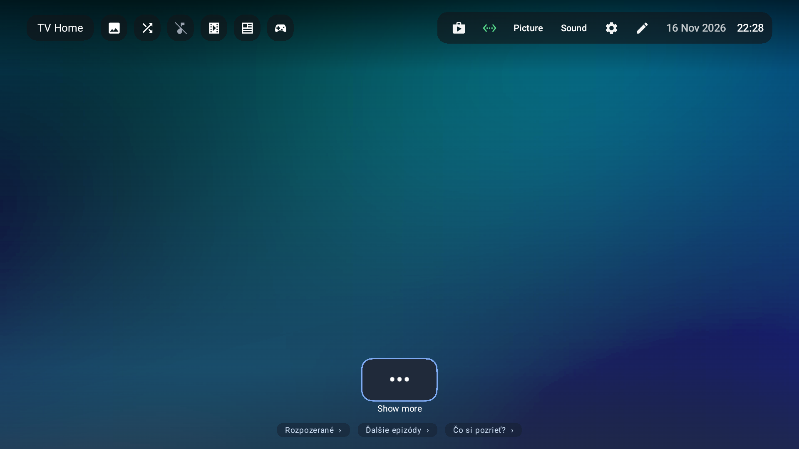
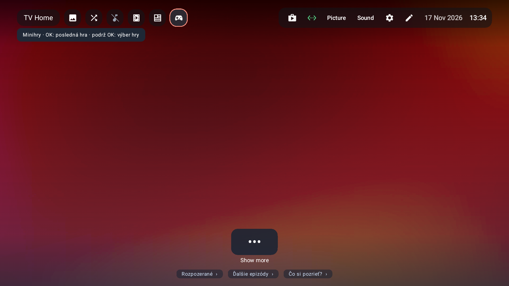
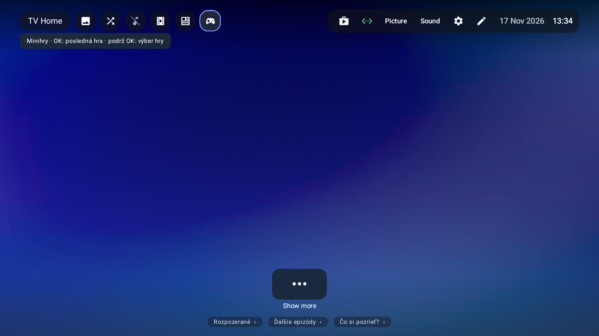
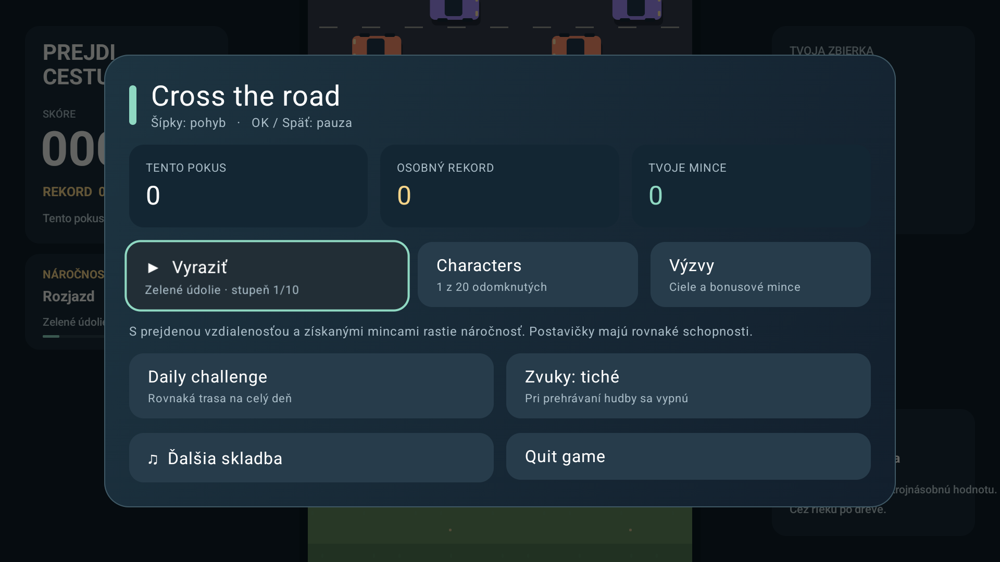
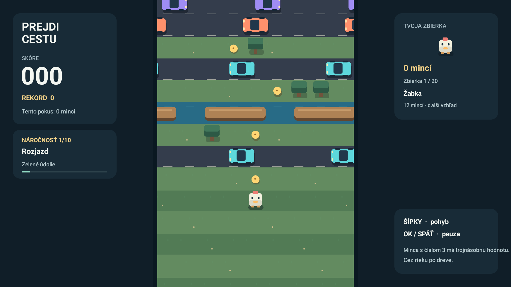

# Gallery and provenance

Unedited Android emulator screenshots captured from the public edition. Backgrounds are the project's original procedural Aurora, Ocean and Ember loops. Game artwork is drawn by the included source. No personal photos, third-party soundtrack artwork or movie posters are used. Empty libraries reflect a new installation; screenshots do not imply that media or accounts are bundled.

The interface is partly localized to English. System metrics are emulator measurements, not hardware requirements. Capture hashes and origin descriptions are listed in `screenshots/manifest.json`; new captures need a human privacy/content review. Application interface licensing and third-party icon/font attribution remain as described in [the notices](../THIRD-PARTY-NOTICES.md).

| Aurora | Ember |
|---|---|
|  |  |

| Road crossing menu | Game in progress |
|---|---|
|  |  |

More settings screenshots are in the [README gallery](../README.md#gallery).
